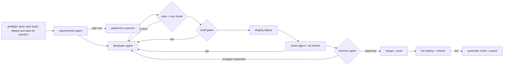

# vm-intent agent pipeline

An automated pipeline that keeps improving vm-intent on its own; you read a **synopsis** when a run is closed out
(`5-control synopsis`). Each **cycle**:

1. a **requirements agent** picks the next requirement (from failing checks, the backlog, gaps between docs and code).
   The first feature cycle of each day is the **daily documentation update**: it brings the docs in line with the
   code and changes no code;
2. a **developer agent** builds it, with unit tests, in its own git worktree;
3. **build gates** run (Maven unit, workflow and replay tests; the web app build);
4. the change is **deployed to staging** (its own Temporal server and backend, on its own ports);
5. a **tester agent** writes acceptance tests for the requirement and runs them against staging, then the
   pipeline runs *every* acceptance test so far, the API contract test and a small load test;
6. a **reviewer agent**, who never saw the developer's reasoning, approves or sends it back;
8. it's **merged to `main` and pushed**, the **live deployment is rebuilt and checked**, and if live
   breaks, the merge is **reverted automatically** and the pipeline pauses.

Any failure goes back to the developer with the error (up to 3 attempts), then the requirement is
abandoned. Every 5th cycle is a **redesign review**: an agent writes a design review and puts up to 3
proposals on the backlog, which later cycles build like any other requirement.



It runs as a Temporal workflow (`src/workflows.ts`), so every stage shows up in the Temporal UI
with its history, survives a restart of the worker, and can be paused, resumed or stopped.

## The guardrails

| Rule | How |
|---|---|
| Agents can only touch what their role allows | Every tool call goes through `src/agents/policy.ts`: the developer may edit `vm-intent/**`; the tester only `vm-intent/tests/acceptance/**`; the reviewer and requirements agents can't write at all. The diff is checked again after every commit, and a commit that breaks a rule is undone. |
| Some files are for people only | `agent-pipeline/**` (this pipeline), `deploy/azure/**`, `deploy/pki/**`, the security code, `*.cmd`/`*.ps1`, CI files. |
| History can't be rewritten | Database migrations and recorded workflow histories can be added to, never changed. |
| No secrets | Agents can't read `.env`, `*.tfvars`, keys or certificates, can't print environment variables, and builds and tests never see the API key. |
| No reaching out | No `curl` except to the staging server, no `ssh`, `docker`, `terraform`, `az`, `git push`; agents can't commit or merge (the pipeline does). |
| Risky work is parked | Requirements the agent rates high-risk (security, sign-in, data deletion, breaking workflow changes) are written up and left for you. |
| Small changes | At most 25 files and 800 lines per change. |
| You decide after a run | You read the synopsis when a run is closed out (`5-control synopsis [days]`), and steer with the backlog. To be asked before each build and merge again, set `approval.beforeBuild` / `beforeMerge` to true in `pipeline.config.json`; then `5-control approve`, `skip`, `reject` answer it. |
| Docs every day | The first feature cycle each day (UTC) is a documentation update (`dailyDocs`, on by default). |
| Money | $3 per agent run, $8 per cycle, $12 and 3 cycles per day (all in `pipeline.config.json`). |
| Stops itself | 3 failed cycles in a row, or any revert, pauses the pipeline until you resume it. |
| Checks the setup first | Before any agent runs, preflight builds and deploys `main` as it is and runs the checks. If that fails, the problem is the setup, so it pauses without spending anything. |

## Set up on basement

You need Node 20+, Git, Java 21 + Maven, Python 3 (`pip install openapi-core requests` for the API
contract test) and the Temporal CLI. All of those except the Python packages are already there for
vm-intent. **For the Docker option**, also Docker Desktop.

0. Run `install-tools.cmd` if `0-check-tools.cmd` shows Git missing: it puts Portable Git in
   `%USERPROFILE%\tools\git` (no admin rights) and the Python packages the contract test needs.
1. Get the repo onto basement with git, if it isn't yet: `git clone https://github.com/johnkettula/shadowforge.git`
   (Git asks you to sign in to GitHub the first time; that's also what lets the pipeline push).
2. Run `agent-pipeline\1-install.cmd`. It creates `settings.cmd` and `pipeline.config.json`.
3. Open `settings.cmd` and paste your Anthropic API key from https://console.anthropic.com.
4. Start Temporal (`vm-intent\1-start-temporal.cmd`), then `agent-pipeline\2-start-worker.cmd`
   (leave that window open).
5. **Dry run first:** `agent-pipeline\3-dry-run.cmd`. It runs one cycle with scripted agents (no AI, no cost,
   nothing pushed) that adds a line to a docs file, which proves cloning, building, staging, the checks and merging
   all work on basement. If preflight fails, the report says exactly what.
6. **Start it:** `agent-pipeline\4-start-pipeline.cmd`.

To use **Docker** for staging and live instead of plain processes, copy the `staging` and `live`
sections of `pipeline.config.docker.json` into `pipeline.config.json`.

## Day to day

```
5-control status            what it's doing now, today's spend, recent cycles
5-control synopsis [days]   what the last run built, what needs a look, and what it cost (default: last day)
5-control approve / skip / reject   only when approvals are turned on (see above)
5-control pause [reason]    lets the current cycle finish, then waits
5-control resume
5-control run-now           skip the wait before the next cycle
5-control stop              stop after the current cycle
5-control reports           every cycle with its outcome and cost
5-control deploy-live       rebuild and check the live copy from main now (not during a cycle)
```

If the live copy on 18080 is stuck (a leftover process from before a reboot or a crash),
`stop-live.cmd` stops whatever is on its ports (18080-18085); `5-control deploy-live` starts it again.
Deploys also do this themselves now: they stop anything left on their own ports, and the backend
runs from a copy of the jar, so Windows can't lock the file a build needs to replace.

After changing the pipeline's code (or pulling an update), run `restart-worker.cmd`: it stops the
running worker and starts a new one; a cycle in progress carries on in the new worker.

- **Reports:** `%USERPROFILE%\agent-pipeline-home\reports\cycle-NNNN.md` (what was built, every attempt,
  every failure). Logs of every build, deploy and check are under `logs\`.
- **Steer it:** add lines to `%USERPROFILE%\agent-pipeline-home\backlog.md`, or change `goals` in
  `pipeline.config.json` (then stop and start again).
- **What it built:** `vm-intent/docs/AGENT-REQUIREMENTS.md` in the repo, plus each merge commit
  (`AP-0007: …`).
- **Live:** the pipeline keeps its own live copy of vm-intent at http://localhost:18080 (Temporal on
  18081, its UI on 18082), separate from the one you start by hand on 8080.
- **Undo something:** `git revert <merge commit>` like any other change.

## Code

| File | What |
|---|---|
| `src/workflows.ts` | The pipeline loop and one cycle, as Temporal workflows |
| `src/activities.ts` | Git worktrees, gates, staging and live deploys, checks, merge, revert, reports, the agent stages |
| `src/agents/policy.ts` | What each agent may do (checked on every tool call) |
| `src/agents/prompts.ts` | What each agent is told |
| `src/agents/runner.ts` | Claude Agent SDK runner, and the scripted runner for tests and dry runs |
| `src/config.ts` | Defaults for vm-intent; `pipeline.config.json` overrides them |
| `test/` | `npm test`: the rules, and full cycles against a real Temporal server and a small fixture repo |

`npm test` needs the Temporal CLI on PATH (or `TEMPORAL_CLI`). The end-to-end tests cover: a
merged change; a failing gate fixed on the second attempt; protected files and changed migrations
undone; a reviewer who never approves; a high-risk requirement parked; a merge that breaks live,
reverted automatically; three failures in a row pausing the pipeline, then resume and stop; a cycle over
budget; a preflight failure stopping everything before any agent runs; and a redesign cycle.
